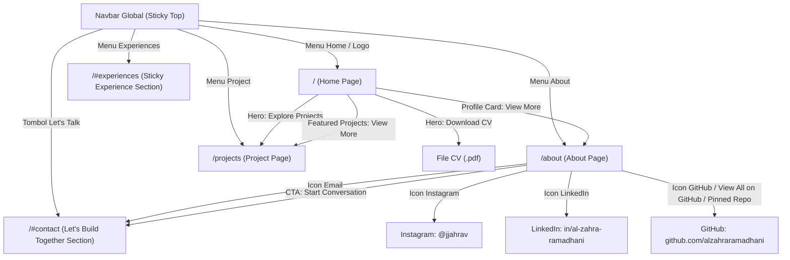

# 01 — Product Requirements Document (PRD)

**Nama Proyek:** Zahra Portfolio V2  
**Pemilik Produk:** Al Zahra Ramadhani (`Junior Software Engineer`)  
**Framework Utama:** Next.js (App Router) + TypeScript  
**Status Dokumen:** Draft Perancangan Awal (v1.0)

---

## 1. Visi & Tujuan Produk
Membangun website portofolio personal berdesain modern (*dark-mode minimalist glassmorphism*) untuk menampilkan identitas profesional, penguasaan teknologi (*web & mobile software engineering*), rekam jejak pendidikan & pengalaman organisasi/kerja, aktivitas *open-source* GitHub secara *real-time*, serta jalur komunikasi langsung bagi perekrut (*HR/Tech Recruiter*) maupun calon klien.

### Target Pengguna (Audiens)
1. **Tech Recruiter & Engineering Manager:** Menilai kualifikasi teknis, konsistensi kontribusi GitHub, riwayat pendidikan/pengalaman, serta mengunduh CV dengan cepat.
2. **Klien Freelance / Kolaborator:** Melihat kualitas antarmuka (UI/UX), kategori project (Website, Mobile, UI/UX), dan menghubungi Zahra melalui formulir atau kontak langsung.
3. **Komunitas Developer / Mahasiswa:** Mengenal profil Zahra sebagai *Google Student Ambassador* dan terhubung lewat sosial media profesional.

---

## 2. Sitemap & Alur Navigasi (User Flow)

Website terdiri dari **3 rute halaman utama**:
1. **`/` (Home Page)** — Landing page komprehensif (Hero, Ringkasan Profil, Featured Projects, Sticky Experience & Education, dan Contact Section).
2. **`/about` (About Page)** — Profil mendalam, sosial media, pengelompokan Tech Stack & Tools, serta statistik *live* GitHub (Contribution Calendar & Pinned Repositories).
3. **`/projects` (Projects Page)** — Katalog lengkap project dengan filter kategori dan paginasi.

---

## 3. Spesifikasi Fungsional per Halaman

### 3.1 Komponen Global (Navbar & Footer)
- **FR-GLOBAL-01 (Navbar):**
  - Kiri: Brand teks `Zahra Portfolio.` (klik kembali ke `/`).
  - Tengah: *Floating pill menu* berisi 4 item:
    - `Home` (`/`)
    - `About` (`/about`)
    - `Project` (`/projects`)
    - `Experiences` (`/#experiences` — melakukan navigasi dan *smooth scroll* ke section Experience di Home Page).
  - Indikator menu aktif memiliki background kapsul putih (`#FFFFFF`) dan teks gelap.
  - Kanan: Tombol kapsul putih `Let's Talk` yang mengarahkan ke `/#contact` (Website eksklusif mengusung *Pure Dark Mode*, sehingga tombol tema di Navbar dihilangkan untuk menjaga estetika minimalis dan fokus).
  - Pada layar *mobile* (`< 768px`), menu tengah beradaptasi menjadi *responsive drawer / compact bottom-or-dropdown menu* agar tetap rapi.
- **FR-GLOBAL-02 (Footer):**
  - Kiri: Teks hak cipta `© 2026 Al Zahra Ramadhani.`
  - Kanan: Tombol `Back to Top ↑` untuk menggulir halus kembali ke puncak halaman (`window.scrollTo({ top: 0, behavior: 'smooth' })`).

---

### 3.2 Halaman Utama — `/` (`Home page.jpg`)

#### A. Hero Section
- **FR-HOME-01:** Menampilkan *headline* dua baris `Crafting Digital` (putih terang) dan `Experiences` (abu-abu metalik), diikuti deskripsi singkat peran sebagai *Junior Software Engineer*.
- **FR-HOME-02:** Dua tombol aksi utama:
  - `Explore Projects ↓`: Menggulir halus ke section `#featured-projects`.
  - `Download CV ↗`: Membuka tab baru / mengunduh berkas PDF CV Zahra.

#### B. Profile Card (Ringkasan)
- **FR-HOME-03:** Menampilkan foto potret Al Zahra Ramadhani di sisi kiri kartu dan informasi ringkas di sisi kanan (Nama, *Role* `Junior Software Engineer`, 1 paragraf deskripsi singkat).
- **FR-HOME-04 (18 Tech Stack Badges):** Bagian `Tech Stack` pada kartu ini **wajib** merender 18 teknologi berikut lengkap dengan ikon masing-masing:
  1. `JavaScript`
  2. `TypeScript`
  3. `React`
  4. `Next.js`
  5. `Tailwind CSS`
  6. `Node.js`
  7. `Express.js`
  8. `Dart`
  9. `Flutter`
  10. `PHP`
  11. `Laravel`
  12. `SQL`
  13. `PostgreSQL`
  14. `Supabase`
  15. `Vite`
  16. `Shadcn UI`
  17. `Git`
  18. `GitHub`
- **FR-HOME-05:** Tautan `View More →` di bagian bawah kanan kartu mengarahkan pengguna ke halaman `/about`.

#### C. Featured Projects Section (`#featured-projects`)
- **FR-HOME-06:** Dilengkapi *tab filter* kategori di kanan atas (`All Projects`, `Mobile`, `Website`, `UI/UX Design`) yang memfilter hingga maksimal 4 project unggulan pada grid `2x2`.
- **FR-HOME-07 (Placeholder Putih & Dummy Text):**
  - Area gambar/thumbnail pada setiap kartu project menggunakan kotak putih polos (`#FFFFFF`) dengan sudut membulat (`rounded-xl`).
  - Konten teks (kategori kecil, tahun, judul project, deskripsi 2 baris, dan tag teknologi) menggunakan *dummy text* sementara hingga data project asli tersedia.
- **FR-HOME-08:** Tombol `View More →` di bawah grid mengarahkan pengguna ke halaman `/projects`.

#### D. Experience, Education & Milestones Section (`#experiences`)
- **FR-HOME-09 (Tanpa View More):** Tombol `View More →` dan efek *gradient fade-out* pemotong kartu di bagian bawah desain Figma **dihapus sepenuhnya**. Seluruh riwayat ditampilkan utuh.
- **FR-HOME-10 (Sticky Left Column & Scrollable Right Column):**
  - Menggunakan layout 2 kolom pada layar desktop (`lg:grid-cols-12` dengan `items-start`).
  - **Kolom Kiri (`lg:col-span-5`, `lg:sticky lg:top-28`):** Berisi judul `Experience, Education & Milestones`, paragraf pengantar, dan kartu `FORMAL EDUCATION` (*Universitas Negeri Malang* & *SMKN 1 Bandung Tulungagung*). Kolom ini **tetap diam di posisinya** selama pengguna menggulir daftar pengalaman di kolom kanan.
  - **Kolom Kanan (`lg:col-span-7`):** Berisi garis *vertical timeline* beserta kartu pengalaman (*Google Student Ambassador*, *Staff Muda - Kominfo* lengkap dengan badge tools & 2 foto lampiran, *Designer Grafis & Video Editor*, dst.) yang **ikut tergulir ke atas** saat pengguna melakukan *scroll* halaman.
  - Pada layar *mobile/tablet kecil* (`< 1024px`), layout otomatis bertumpuk vertikal secara responsif (Pendidikan di atas atau di bawah pengantar, lalu diikuti timeline pengalaman) agar layar kecil tidak terpotong.

#### E. Contact Section — "Let's build together." (`#contact`)
- **FR-HOME-11 (Contact Form):** Formulir di sisi kiri memiliki input:
  - `Name` (wajib diisi)
  - `Email Address` (wajib format email valid)
  - `Project Title or Role Subject` (wajib diisi)
  - `Project Details & Message` (textarea, wajib diisi)
  - Tombol `Send Message` dengan indikator *loading* dan notifikasi berhasil/gagal (*toast*).
- **FR-HOME-12 (Direct Contact & Location Cards):** Kolom kanan menampilkan:
  - **Direct Mail:** `alzahra.workhub@gmail.com` dengan tombol **Copy to Clipboard** (menampilkan feedback *"Copied!"*).
  - **LinkedIn:** Mengarah ke `https://www.linkedin.com/in/al-zahra-ramadhani/` (tab baru).
  - **GitHub:** Mengarah ke `https://github.com/alzahraramadhani/` (tab baru).
  - **Instagram:** `@jjahrav` mengarah ke `https://www.instagram.com/jjahrav/` (tab baru).
  - **Primary Base:** `Malang, Jawa Timur, Indonesia` dilengkapi visual peta gelap Kota Malang dan indikator status `● UTC+7 (WIB) Available`.

---

### 3.3 Halaman About — `/about` (`About Page.jpg`)

- **FR-ABOUT-01 (Expanded Profile Card):**
  - Menampilkan kartu profil yang serupa dengan Home Page, namun **tanpa daftar Tech Stack di dalam kartu** dan digantikan dengan **deskripsi naratif yang lebih panjang (2 paragraf)** serta deretan **Social Media**.
  - 4 tombol ikon bundar di bawah label `Social Media`:
    1. **GitHub:** `https://github.com/alzahraramadhani/` (`target="_blank"`)
    2. **LinkedIn:** `https://www.linkedin.com/in/al-zahra-ramadhani/` (`target="_blank"`)
    3. **Instagram:** `https://www.instagram.com/jjahrav/` (`target="_blank"`)
    4. **Email:** Navigasi ke `/#contact` (masuk ke bagian Contact di bawah Home Page).
- **FR-ABOUT-02 (Tech Stack & Tools):**
  - Menampilkan 3 kartu kategori berdampingan (`Frontend`, `Backend`, `Mobile & Tools`) berisi *badge* teknologi beserta ikonnya.
- **FR-ABOUT-03 (Live GitHub Contribution Activity):**
  - Mengambil data kontribusi 1 tahun terakhir langsung dari akun GitHub `alzahraramadhani`.
  - Merender *heatmap* kalender kontribusi (`Jan`–`Dec`, `Mon`–`Sun`) dengan skema warna khas desain (gradasi gelap -> biru tua/indigo -> ungu lembut -> putih terang) beserta *tooltip* jumlah kontribusi per tanggal saat di-*hover*.
  - Menampilkan keterangan waktu sinkronisasi data.
- **FR-ABOUT-04 (Live Pinned Repositories):**
  - Mengambil daftar *Pinned Repositories* langsung dari profil GitHub `alzahraramadhani`.
  - Menampilkan kartu repositori (nama repo, badge `Public`, deskripsi repo, bahasa pemrograman utama beserta titik warnanya, jumlah *stars* `☆`, dan jumlah *forks* `⑂`).
  - Klik kartu repo akan membuka halaman repositori terkait di GitHub; klik `VIEW ALL ON GITHUB →` membuka `https://github.com/alzahraramadhani/?tab=repositories`.
  - *Fallback otomatis:* Jika belum ada repo yang di-*pin* di akun GitHub, sistem otomatis menampilkan 3–6 repositori publik terbaru/terpopuler agar UI tidak pernah kosong.
- **FR-ABOUT-05 (Collaboration CTA Banner):**
  - Kartu ajakan *"Interested in collaborating or hiring?"* dengan tombol `Start Conversation` yang mengarah ke `/#contact`.

---

### 3.4 Halaman Projects — `/projects` (`Project Page.jpg`)

- **FR-PROJ-01 (Header & Filter Kategori):**
  - Menampilkan judul `All Projects.` dan deskripsi pengantar.
  - Bar filter kategori terpusat: `All Projects`, `Web Applications`, `Mobile Apps`, `UI/UX Design`.
- **FR-PROJ-02 (Grid Project & Dummy State):**
  - Menampilkan grid 2 kolom x 3 baris (maksimal **6 kartu per halaman**).
  - Sama seperti Featured Projects di Home, saat ini menggunakan kotak thumbnail putih (`#FFFFFF`) dan teks *dummy*.
- **FR-PROJ-03 (Paginasi):**
  - Komponen navigasi halaman (`< Prev`, nomor halaman `1`, `2`, `3`, `Next >`) yang berfungsi secara interaktif membagi daftar project (6 item per halaman) dan di-reset ke halaman `1` setiap kali filter kategori berubah.

---

## 4. Kebutuhan Non-Fungsional (NFR)
1. **Performa:** Skor Lighthouse Performance >= 90; pemanggilan API GitHub dijalankan di sisi server (*Next.js Server Components / ISR*) sehingga tidak membebani browser pengunjung dan aman dari tereksposnya token.
2. **Keamanan:** `GITHUB_TOKEN` dan API Key layanan email hanya disimpan di variabel environment server (`.env.local`), tidak pernah menggunakan prefix `NEXT_PUBLIC_`.
3. **Responsivitas:** Tampil proporsional di Mobile (`360px–767px`), Tablet (`768px–1023px`), dan Desktop (`1024px–1440px+`).
4. **Aksesibilitas & SEO:** Penggunaan tag HTML semantik (`header`, `main`, `section`, `footer`, `nav`), atribut `aria-label` pada tombol ikon sosial media, kontras teks memadai, serta metadata OpenGraph untuk pratinjau link di LinkedIn/WhatsApp.

